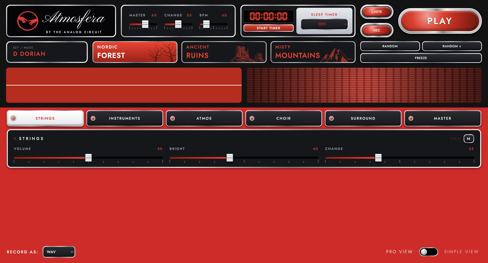

# Atmosfera by The Analog Circuit

A generative ambient soundscape instrument in **one HTML file**. Every sound is synthesised live with the Web Audio API: no samples, no server, no install.

## Use it
1. Download `index.html` (or clone this repo).
2. Open it in a modern browser (Chrome, Edge, Firefox, Safari). It works offline.
3. Press **START**, pick a preset or hit **Randomise**, and listen.

Live version: https://theanalogcircuit.github.io/atmosfera/

## Features
- Five layers: Atmosphere, Choir, Strings, Environment, Bells/Sparks, plus Dynamic Drone and an Instrument Rack
- Presets: Nordic Forest, Ancient Ruins, Misty Mountains
- Sleep timer up to 6 hours, with a gentle fade-out
- Record your soundscape and save it as **WAV or MP3** (works offline)
- Master view, simple view, and six skins

## Make your own
Fork it, change it, share it. The whole app is `index.html`; open it in any text editor.

## License
MIT. Free to use, modify and redistribute, provided the copyright notice ("Copyright (c) 2026 theanalogcircuit") stays with copies. See `LICENSE`.
The bundled MP3 encoder (lamejs) is LGPL-3.0; see `THIRD_PARTY_NOTICES.md`.

## Preview

